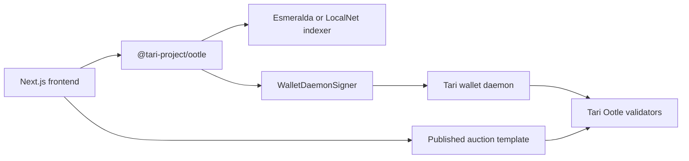

# SEANCE

Confidential sealed-bid auctions for Tari Ootle.

[](LICENSE) [](template) [](https://ootle.tari.com/)

> Hero image placeholder: `public/seance-hero.png`

## Overview

SEANCE is an auction interface for Tari Ootle. It uses commit/reveal bidding: participants first submit a hash of their amount and a secret salt, then reveal both after bidding closes. The template verifies the reveal before selecting a winner.

The repository contains a polished frontend, a tested auction-rule core, a published Tari WASM adapter, and a real Tari Ootle SDK connection path. The adapter is published on Esmeralda at `template_71f5c279c39d18ad7ca19b3f072a74e4fe61e83b188a2ffe771b9373923b0f8a`. The live UI refuses to fabricate component state until a real auction component address and deposit resource are configured. Demo Mode remains available as an offline preview and is off by default.

## Features

- Live-mode connection to the Esmeralda Ootle indexer and a local Tari wallet daemon.
- Wallet-daemon signing through the official TypeScript SDK; private keys stay in the daemon.
- Explicit offline preview mode labelled `SIMULATION`.
- Commit/reveal auction UI: seal a commitment, close bidding, reveal the amount and salt, settle, and refund.
- Rust tests for valid flow, wrong salt, late commit, late reveal, no reveal, ties, duplicate commits, zero bids, and seller authorization.
- Chain-versus-human privacy panel that shows only verified live fields.

## How privacy works

During the commit phase, the bidder submits `SHA-256(amount + ":" + salt)` and a deposit. The amount and salt are hidden while bidding. The bidder must reveal the same amount and salt after bidding closes; the template verifies the hash. Unrevealed bids forfeit their deposit to the seller. The highest verified reveal wins, verified losers are refunded, and ties go to the earliest committed bid.

Tari confidential resources hide balances in vaults, so deposit amounts can also be hidden when the deployed adapter uses a confidential vault. If a public resource is used instead, deposit amounts are visible. The bid amount is intentionally revealed at close. Fees, timing, transaction structure, revealed fields, and identity-linked public calls remain visible.

The Rust rules are tested locally and the adapter compiles against `tari_template_lib 0.35.0`. The adapter has not yet been published to Esmeralda, so the live UI does not claim that an auction action is on-chain until real addresses and receipts are configured.

## Architecture



## Tech stack

- Next.js 16 App Router and TypeScript
- Tailwind CSS, custom CSS, GSAP-ready interaction layer, Lenis-ready scroll layer
- Rust auction-rule core and Tari Ootle template target
- `@tari-project/ootle`, `@tari-project/ootle-indexer`, and `@tari-project/ootle-wallet-daemon-signer`
- Esmeralda testnet or Tari LocalNet

## Getting started

### Frontend

Prerequisites: Node.js 22+, npm, Rust, Cargo, and a Tari Ootle wallet daemon.

```bash
npm install
npm run dev
```

Open `http://localhost:3000`. Live Mode is the default. The app connects to Esmeralda wallet JSON-RPC at `http://127.0.0.1:5100/json_rpc`. For WebAuthn from this app, start the daemon with `--enable-vite-dev-port 3000` so its allowed origin is exactly `http://localhost:3000`; the daemon's current `http://localhost:5100` allow-list will reject this app origin. Set `NEXT_PUBLIC_TARI_WALLETD_URL` only when using a different JSON-RPC endpoint. Set `NEXT_PUBLIC_SEANCE_COMPONENT_ADDRESS` and `NEXT_PUBLIC_SEANCE_DEPOSIT_RESOURCE` only after publishing a real auction component.

### Esmeralda testnet

Download a matching `tari_ootle_walletd` release, then run:

```bash
./tari_ootle_walletd --network esme
```

The wallet UI is at `http://localhost:5100`. Public testnet faucet balances may be empty. The documented funding path is to burn Minotari and claim the burn proof in the Ootle wallet.

### LocalNet

Clone `tari` and `tari-ootle` side by side, install the WASM target, then run from the `tari-ootle` checkout:

```bash
rustup target add wasm32-unknown-unknown
cargo run --bin tari_swarm_daemon --release -- -c data/swarm/config.toml init
cargo run --bin tari_swarm_daemon --release -- -c data/swarm/config.toml start
```

The swarm admin UI is at `http://localhost:8080`; it starts a wallet, validator, indexer, and funded local faucet.

## Usage

1. Start a wallet daemon and connect it from the Live Mode banner.
2. Build and publish the Tari auction template with `scripts/build-seance-template.sh` and `scripts/publish-seance-template.mjs`, then configure the real component address and deposit resource.
3. Create an auction by calling `instantiate(seller, deposit_resource)` through the wallet-signed component call. The currently published adapter has manual close/reveal/settle phases; it does not encode epoch windows or a minimum bid.
4. Place commitments using the wallet’s confidential-resource flow where supported.
5. Close bidding, reveal each amount and salt, settle the highest verified reveal, and refund verified losers.

If the wallet daemon or template address is unavailable, the UI reports the missing prerequisite and submits nothing. Demo Mode can be enabled manually for an offline preview.

## Project structure

```text
src/app/       Next.js page, metadata, and visual system
src/lib/       Tari SDK connection and transaction boundary
template/      Rust rules and tari_template_lib WASM adapter
docs/          Tari research and privacy notes
scripts/       Repeatable local test commands
```

## Testing

```bash
npm run lint
npm run test:template
npx next build --webpack
```

For the full wallet, three-account, local-swarm flow, see [TESTING.md](TESTING.md). The adapter build is verified; deployment and transaction receipts remain environment-dependent and are not fabricated here.

## Roadmap

- Publish the compiled template to LocalNet, then Esmeralda, and record its address here.
- Implement wallet-daemon JRPC calls for confidential bid deposits and owned-output settlement.
- Add verified transaction receipts and real substate data to the chain proof panel.
- Add browser integration tests against a reproducible LocalNet fixture.

## Contributing

Keep changes small, run lint and Rust tests, do not commit `.env` files, wallet databases, seeds, private keys, or generated build output, and explain any privacy claim with a reproducible chain observation.

## License

MIT. See [LICENSE](LICENSE).

## Acknowledgements

Built against the Tari Ootle protocol and its open-source TypeScript SDK.
